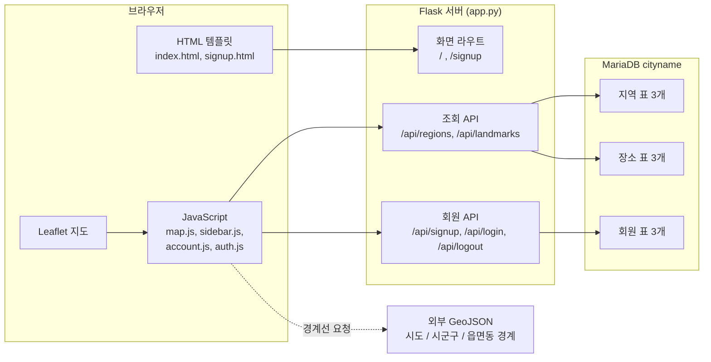
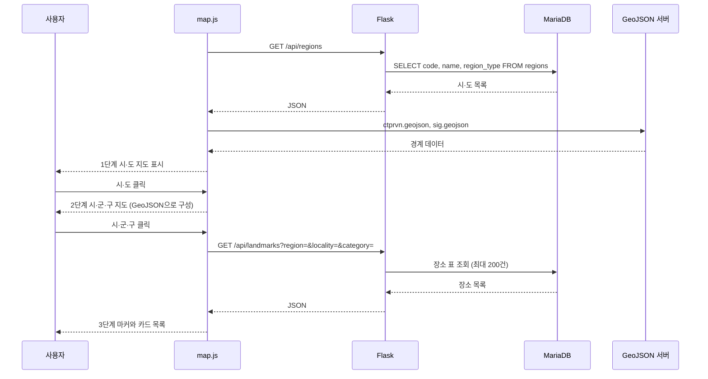

# 서비스 구조도

2026-10-15 기준 이 저장소(원격 main `54ec5cf`)의 코드를 읽어 정리한 서비스 구조도입니다. 프로젝트 뼈대(DB, Flask 서버, HTML 구조)를 설명할 때 씁니다. DB 표 구조는 [db erd.md](db%20erd.md)에 있습니다.

## 전체 구조 (3층)



- 지도 배경은 OpenStreetMap 타일을 쓰지 않고, 행정구역 GeoJSON 경계만으로 한국 지도를 그립니다.
- GeoJSON은 `static/geo/`를 먼저 찾지만 이 폴더가 저장소에 없어서, 실제로는 jsDelivr(`KnellBalm/kr-admin-geojson`)와 GitHub raw에서 받습니다. 인터넷이 없으면 지도가 뜨지 않습니다.

## 사용자 흐름 (지도 탐색)



- 카테고리 필터(전체, 관광지, 맛집, 행사)를 누르면 같은 API를 `category`만 바꿔 다시 호출합니다.
- 사이드바의 "전국 여행 장소" 버튼은 `scope=all`로 지역 선택 없이 전국 데이터를 조회합니다.
- 연속 클릭으로 늦게 온 응답이 화면을 덮어쓰지 않도록 `fetchToken`으로 응답을 구분합니다.

## Flask 서버 (`app.py`)

| 구분 | 경로 | 하는 일 |
| --- | --- | --- |
| 화면 | `GET /` | 지도 화면(`index.html`) 렌더링 |
| 화면 | `GET /signup` | 회원가입 화면. 여행 스타일 5종을 템플릿에 전달 |
| 조회 | `GET /api/regions` | `regions`를 `display_order` 순으로 반환 |
| 조회 | `GET /api/landmarks` | `region`(2자리 숫자), `locality`, `category` 또는 `scope=all`로 장소 조회 |
| 회원 | `POST /api/signup` | 입력 검증 후 `members`에 저장, 중복 아이디는 409 |
| 회원 | `POST /api/login` | 비밀번호 해시 비교 후 세션에 회원 ID와 이름 저장 |
| 회원 | `POST /api/logout` | 세션 삭제 |

- **DB 접속**: 요청마다 연결을 열고 닫습니다. 접속 정보(`DB_HOST`, `DB_PORT`, `DB_USER`, `DB_PASSWORD`)는 `.env` 환경변수에서 읽습니다.
- **SQL 인젝션 방어**: 장소 표 이름은 코드의 화이트리스트(`tourism`, `food`, `event`)에서만 고르고, 사용자 입력은 모두 `%s`로 바인딩합니다.
- **회원 보안**: 세션 쿠키는 HttpOnly, SameSite=Lax이고, 회원 API는 세션에 저장한 CSRF 토큰(`X-CSRF-Token` 헤더)을 확인합니다. 비밀번호는 Werkzeug 해시로만 저장합니다.
- **`members` 표 자동 생성**: 가입이나 로그인 시 표가 없으면 `CREATE TABLE IF NOT EXISTS`로 만듭니다. CREATE 권한이 없는 환경에서는 `db/members.sql`을 먼저 실행해야 합니다.
- 주요 의존 패키지는 Flask 3.1.3, PyMySQL 1.2.3, python-dotenv 1.2.4입니다.

## 프론트엔드 구조

```text
templates/
  index.html     지도 화면: 사이드바 + 지도 + 로그인 카드
  signup.html    회원가입 화면
static/
  css/style.css  전체 스타일(입체 지도 효과, 사이드바, 로그인 카드)
  js/map.js      지도 탐색 로직 (3단계, 마커, 카드, 전국 조회)
  js/sidebar.js  왼쪽 여행 패널 열고 닫기(드래그 손잡이)
  js/account.js  로그인·가입 폼 동작
  js/auth.js     로그인·가입·로그아웃 요청 전송
  images/
    regions/     지역 로고 SVG 247개 (지역 코드_영문명 폴더)
    tourist/     관광지 종류별 아이콘 SVG
    food/        맛집 종류별 아이콘 SVG 30개
```

- **화면 구성**: `index.html`은 왼쪽 사이드바(단계 안내, 경로 표시, 지역 버튼, 카테고리 필터, 장소 카드)와 오른쪽 지도 영역(바다 배경, 지도, 로그인 카드, 안내 문구)으로 나뉩니다.
- **`map.js`의 상태 관리**: 선택한 지역, 시·군·구, 카테고리, 레이어를 `state` 객체 하나로 관리하고, 단계별 함수(`goHome`, `selectRegion`, `selectCity`, `loadLandmarks`)가 화면을 바꿉니다.
- **도의 자치구는 시로 묶고**(수원시 장안구는 수원시), 세종은 하위 구역이 없어 읍·면·동 경계로 대신하며, 제주, 울릉, 독도는 확대해서 표시합니다.
- **마커는 현재 이모지**(관광지, 맛집, 행사)를 씁니다. `static/images`의 아이콘과 지역 로고는 아직 지도에 연결되지 않았습니다.

## 폴더 구조

```text
.
├── app.py                 Flask 서버와 API
├── templates/             HTML 템플릿
├── static/                CSS, JavaScript, 이미지
├── db/                    DB 스키마, 임시 SQL, 마이그레이션, 데이터랩 맛집 자료
│   ├── current/           현재 구조(00_schema.sql, 01-09 임시 SQL, 공식 관광 링크 CSV)
│   ├── migrations/        2026-10-14 맛집 순위·보강 마이그레이션
│   ├── cityname_split/    이전 구조 SQL (참고용)
│   ├── legacy/            초기 덤프 (사용 안 함)
│   └── data/              데이터랩 맛집 TOP20 원본 ZIP
├── docs/                  README, ERD, 회원 기능 설명, 작업일지, 회의록
├── import_geojson_regions.py  GeoJSON 코드를 지역 표에 연결하는 스크립트
├── requirements.txt       Python 패키지 목록
└── README.md
```

## 구현 상태 (2026-10-15 저장소 기준)

| 기능 | 상태 | 비고 |
| --- | --- | --- |
| 지도 3단계 탐색 | 구현 | 시·도, 시·군·구, 장소 |
| 카테고리 필터, 전국 조회 | 구현 | 전국 조회는 `LIMIT`이 없음 |
| 회원 API (가입, 로그인, 로그아웃) | 서버 구현 | 모의 DB 테스트만 했다고 `member-auth.md`에 적힘 |
| 로그인·가입의 브라우저 연결 | 확인 필요 | 아래 참고 |
| 방문 기록(사진, 리뷰), 즐겨찾기, 프로필 | 표만 있음 | 코드가 원격 main에 없음 |
| 스탬프, 포인트, 랭킹 | 없음 | 표도 아직 없음 |
| 아이콘, 지역 로고의 지도 연결 | 없음 | 파일만 준비됨 |

## 알려진 이슈와 확인 필요

- **로그인·가입이 브라우저에서 동작하지 않을 가능성이 있습니다.** 두 템플릿이 모두 `account.js`만 불러오는데, 원격 main의 이 파일은 "로그인 기능은 아직 연결되지 않았습니다"를 띄우는 임시 코드입니다. 실제 요청을 보내는 `auth.js`는 어떤 템플릿에도 연결되어 있지 않습니다. 코드만 읽고 내린 판단이라 브라우저에서 확인이 필요합니다.
- **문서가 코드보다 앞서 있습니다.** `db erd.md`와 `member-auth.md`가 설명하는 `/profile`, `visits.py`, `favorites.py`, `visits.js`, `favorites.js`가 원격 main에 없습니다. 아직 올리지 않은 로컬 작업일 수 있으며, 그렇다면 위 로그인 문제도 이미 해결됐을 수 있습니다.
- **전국 조회에 `LIMIT`이 없습니다.** 행사만 1만 건이 넘어 한 번에 마커로 그려지면 느려질 수 있습니다.
- **`DB_PASSWORD`, `DB_USER` 기본값**이 `app.py`에 남아 있습니다. 공개 저장소이므로 기본값을 없애는 편이 안전합니다.
- **GeoJSON이 외부 서버에 의존합니다.** 인터넷이 막힌 환경에서는 지도가 뜨지 않으므로 `static/geo/`에 내려받아 두거나 녹화 영상을 준비합니다.
- **강원 코드 불일치**: 지역 로고 폴더는 DB 코드 42를 따르는데 지도 GeoJSON은 51을 씁니다(10-13 확인). 로고를 지도에 연결할 때 변환이 필요합니다.
