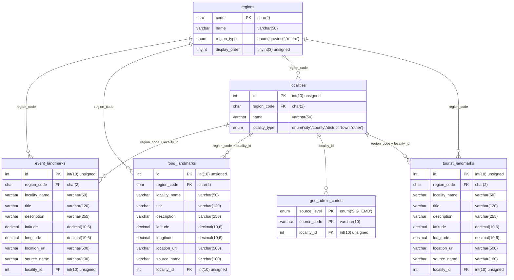

# cityname ERD

2026-10-14 기준, 로컬 MariaDB의 information_schema에서 실제 테이블·컬럼·외래키를 읽어 작성했습니다. DB 데이터와 웹 기능은 변경하지 않았습니다.

일반 테이블 6개, 뷰 3개입니다. 아래 ERD는 일반 테이블 전체 컬럼과 실제 외래키 관계를 표시합니다. PK는 기본키, FK는 외래키이며 모든 컬럼은 NOT NULL입니다.

관광지·맛집·행사의 `region_code`는 `regions.code`를 참조합니다. `(region_code, locality_id)`는 `localities.(region_code, id)`를 참조하는 복합 외래키입니다. `geo_admin_codes`의 기본키는 `(source_level, source_code)`입니다.

뷰는 `v_all_places`, `v_landmarks`, `v_landmark_counts`입니다. 뷰는 별도 데이터 저장 테이블이 아니므로 위 테이블 ERD에서 제외했습니다.
