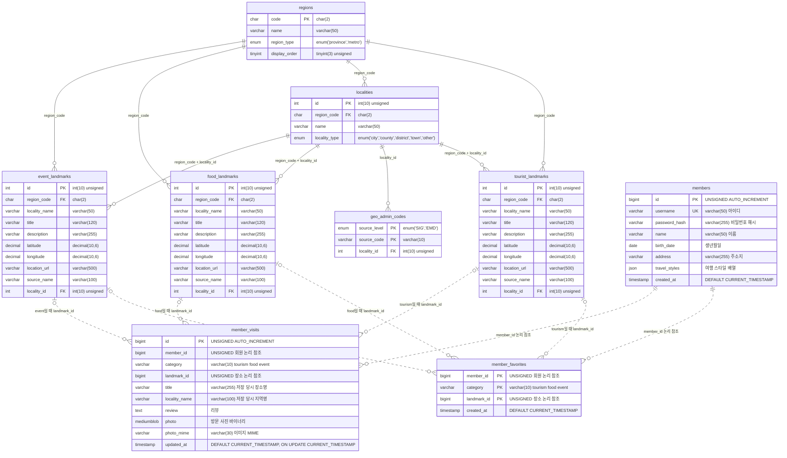

# cityname ERD

2026-10-14 기준. 기존 문서에 기록된 지역·장소 테이블 6개와 뷰 3개에, 현재 코드와 SQL에 정의된 회원·방문 기록·즐겨찾기 테이블 3개를 반영했습니다. 이번 수정에서는 실제 DB를 다시 조회하지 않았으므로 새 테이블의 생성 여부는 별도 확인해야 합니다. 이 문서 수정으로 DB나 웹 기능은 변경하지 않습니다.

전체 기능을 사용하는 구성은 **일반 테이블 9개, 기존 문서 기준 뷰 3개**입니다. PK는 기본키, FK는 DB 외래키, UK는 고유 제약입니다. 아래 컬럼은 모두 NOT NULL입니다. 새 테이블은 InnoDB, utf8mb4를 사용하며 JSON은 MariaDB의 JSON 타입으로 선언합니다.

실선은 기존 DB 외래키 관계이고, 점선은 애플리케이션이 해석하는 논리적 참조입니다. 회원·방문·즐겨찾기 사이에는 현재 DB 외래키 제약이 선언되어 있지 않습니다.

관광지·맛집·행사의 `region_code`는 `regions.code`를 참조합니다. `(region_code, locality_id)`는 `localities.(region_code, id)`를 참조하는 복합 외래키입니다. `geo_admin_codes`의 기본키는 `(source_level, source_code)`입니다.

뷰는 `v_all_places`, `v_landmarks`, `v_landmark_counts`입니다. 뷰는 별도 데이터 저장 테이블이 아니므로 위 테이블 ERD에서 제외했습니다.

## 테이블 역할과 제약

| 테이블 | 역할 | 기본키·고유 제약 |
| --- | --- | --- |
| `regions` | 시·도, 특별시·광역시 정보 | PK `code` |
| `localities` | 시·군·구 및 읍·면·동 단위 지역 | PK `id`, UNIQUE `(region_code, name)`, UNIQUE `(region_code, id)` |
| `geo_admin_codes` | GeoJSON SIG/EMD 코드와 지역의 연결 | 복합 PK `(source_level, source_code)` |
| `tourist_landmarks` | 관광지 정보 | PK `id` |
| `food_landmarks` | 맛집 정보 | PK `id` |
| `event_landmarks` | 행사 정보 | PK `id` |
| `members` | 회원가입·로그인·내 프로필 | PK `id`, UNIQUE `username` |
| `member_visits` | 회원별 방문 사진과 리뷰 | PK `id`, UNIQUE `unique_member_place(member_id, category, landmark_id)` |
| `member_favorites` | 회원별 즐겨찾기 장소 | 복합 PK `(member_id, category, landmark_id)` |

기존 지역·장소 외래키는 팀 배포 스크립트 기준 `ON UPDATE RESTRICT`, `ON DELETE RESTRICT`입니다. 장소 테이블에는 `(region_code, locality_name)`, `locality_id`, `(region_code, locality_id)` 조회 인덱스가 있습니다. `geo_admin_codes`에는 `locality_id` 인덱스가 있습니다.

### 장소 참조 방식

`member_visits`와 `member_favorites`는 `category`와 `landmark_id`를 함께 사용합니다. 같은 숫자 ID라도 분류가 다르면 다른 장소입니다.

| category | 참조하는 장소 |
| --- | --- |
| `tourism` | `tourist_landmarks.id` |
| `food` | `food_landmarks.id` |
| `event` | `event_landmarks.id` |

ERD의 장소 점선 세 개는 **분류에 따라 선택되는 대체 관계**입니다. 한 기록이 세 테이블 모두를 참조하는 관계가 아닙니다. 저장 요청 시 서버가 분류를 검증하고 대상 장소의 존재를 확인합니다. 분류 값은 VARCHAR로 저장하며 DB CHECK/ENUM 제약으로 제한하지는 않습니다.

회원 ID는 요청에서 받지 않고 로그인 세션에서 가져옵니다. 새 테이블에 외래키가 없으므로 회원이나 원본 장소를 DB에서 직접 삭제할 때 방문 기록·즐겨찾기가 자동 삭제되지는 않습니다. 현재 회원·장소 삭제 기능이나 연쇄 삭제 처리는 없습니다.

## 회원가입·로그인·프로필

- 가입 정보: 이름, 생년월일, 아이디, 비밀번호, 주소지, 여행 스타일. 비밀번호 확인은 검증에만 사용하고 저장하지 않습니다.
- 아이디는 영문·숫자·밑줄 4~50자, 비밀번호는 8~128자입니다. 서버에서 미래 생년월일과 빈 필드도 검증합니다.
- 아이디 중복은 `members.username`의 UNIQUE 제약으로 막고, 중복 시 HTTP 409와 `이미 있는 id/pw입니다`를 반환합니다. 비밀번호 자체는 고유값이 아니며 다른 회원과 같을 수 있습니다. 아이디 비교의 대소문자 구분은 실제 DB 컬럼 collation을 따릅니다.
- 비밀번호는 Werkzeug 해시만 저장합니다. 로그인 검증 이외에 원문 비밀번호를 저장하거나 프로필에서 조회하지 않습니다.
- `travel_styles`는 아래 값 중 하나 이상 선택한 JSON 배열입니다. 중복 선택은 제거하고 저장합니다. 현재 구현된 스타일은 다섯 가지입니다.

| 여행 스타일 |
| --- |
| 힐링/자연 |
| 액티비티/모험 |
| 역사/문화 |
| 감성/도시 |
| 축제/체험형 |

로그인 성공 시 세션에 회원 ID와 이름을 기록합니다. 오른쪽 상단에 이름 첫 글자 아이콘과 프로필 링크가 나타나며, `/profile`에서는 본인의 이름·생년월일·아이디·주소지·여행 스타일을 조회합니다. 비로그인 접근은 지도 화면으로 이동시킵니다. 인증 상태는 별도 로그인 테이블이 아닌 Flask 세션으로 관리합니다.

## 방문 사진·리뷰와 방문 수

- 로그인한 회원이 장소 팝업에서 사진과 리뷰를 저장하면 방문 완료로 처리하고 지도 마커 위에 체크를 표시합니다.
- 첫 기록에는 사진과 리뷰가 모두 필요합니다. 리뷰는 앞뒤 공백 제거 후 1~2000자입니다. 사진은 JPG·PNG·WebP, 최대 5MB이며 서버에서 파일 시그니처와 크기를 확인합니다.
- 사진은 파일 경로가 아니라 `photo` 컬럼의 바이너리로 저장합니다. `photo_mime`은 응답의 이미지 타입입니다. 사진 조회는 해당 기록의 회원 ID와 세션을 대조합니다.
- 같은 회원·분류·장소는 UNIQUE 제약과 UPSERT로 하나의 기록만 유지합니다. 재저장은 리뷰와 사진을 갱신하며, 새 사진을 생략하면 기존 사진을 유지합니다. `updated_at`은 마지막 DB 변경 시각이며 실제 방문일을 별도로 저장하지는 않습니다.
- `title`, `locality_name`은 서버가 원본 장소에서 읽어 저장하는 스냅샷입니다. 원본 장소명이 나중에 바뀌어도 기존 기록은 다음 저장 전까지 이전 값을 유지합니다.
- 프로필에서 관광지·맛집·행사별 사진과 리뷰를 표시하고, 아래에 분류별 방문 수 및 총 방문 수를 표시합니다.
- **총 방문 수는 로그인한 회원의 방문 기록 행 수, 즉 중복 없는 장소 수입니다.** 같은 장소에 여러 번 가거나 리뷰를 수정해도 숫자가 늘어나지 않습니다. 전체 장소 수는 세 장소 테이블 각각의 `COUNT(*)` 합계입니다. 즐겨찾기는 방문 수에 포함하지 않습니다.

## 즐겨찾기

- 로그인한 회원이 장소 팝업이나 목록에서 등록·해제합니다. 등록은 중복 키가 있어도 추가 행을 만들지 않으며, 해제는 현재 회원의 해당 기록만 삭제합니다.
- 왼쪽 패널의 ‘★ 즐겨찾기 장소’를 누르면 해당 회원이 저장한 장소만 지도와 목록에 표시합니다. 마커에는 등장 애니메이션을 적용합니다.
- 즐겨찾기 목록은 분류별 원본 장소 테이블과 JOIN하여 현재 장소 정보를 읽습니다. 삭제된 원본 장소는 목록에서 제외되지만, 외래키가 없으므로 즐겨찾기 행 자체는 남을 수 있습니다.
- 즐겨찾기 등록과 방문 완료는 서로 독립적입니다. 즐겨찾기에는 사진·리뷰를 저장하지 않습니다.

## 관련 코드와 SQL

| 기능 | 코드 | 추가 테이블 생성 SQL |
| --- | --- | --- |
| 회원가입·로그인·프로필 | `app.py`, `static/js/account.js` | `db/members.sql` |
| 방문 기록 | `visits.py`, `static/js/visits.js` | `db/member_visits.sql` |
| 즐겨찾기 | `favorites.py`, `static/js/favorites.js` | `db/member_favorites.sql` |
| 지역·장소 연결 및 팀 배포 | `import_geojson_regions.py`, `inbox/team/make_team_sql_dump.py` | 팀 배포용 지역·장소 SQL |

신규 테이블은 `CREATE TABLE IF NOT EXISTS`로 자동 생성합니다. `members`는 로그인·회원가입 시, 방문 기록·즐겨찾기는 해당 기능 조회·저장 시 생성됩니다. 로그인 상태로 지도에 접속하면 방문 기록과 즐겨찾기를 조회하므로 두 테이블이 생성될 수 있습니다. DB 사용자에게 CREATE 권한이 없으면 관리자가 위 SQL을 먼저 실행해야 합니다. 이 구문은 이미 존재하는 테이블의 컬럼이나 제약을 변경하는 마이그레이션은 수행하지 않습니다.

현재 `inbox/team/make_team_sql_dump.py`의 일반 테이블 내보내기 대상은 **기존 지역·장소 테이블 6개뿐**입니다. 회원·방문 기록·즐겨찾기 데이터는 포함하지 않으므로 서비스 이전 시 별도로 백업해야 합니다. 추가 생성 SQL 세 개는 테이블 구조만 만들며 기존 회원 데이터나 사진을 복원하지 않습니다. 사진을 DB에 저장하므로 DB의 `max_allowed_packet`도 업로드 크기를 수용해야 합니다(예: 16MB 이상).

기존 `db/current/cityname_landmarks_1013.sql`과 루트의 이전 00~05 SQL은 현재 확장된 회원·지역·장소 전체를 복원하는 통합 백업이 아닙니다. 특히 초기화 SQL을 기존 서비스 DB에 재실행하면 데이터가 삭제되거나 테이블 구조가 달라질 수 있으므로, 현재 DB의 전체 백업과 구분해야 합니다.

지도 패널, 확대, 입체 효과, 블러, 프로필 아이콘 및 마커 애니메이션은 화면 처리이며 별도 DB 테이블을 추가하지 않습니다.
