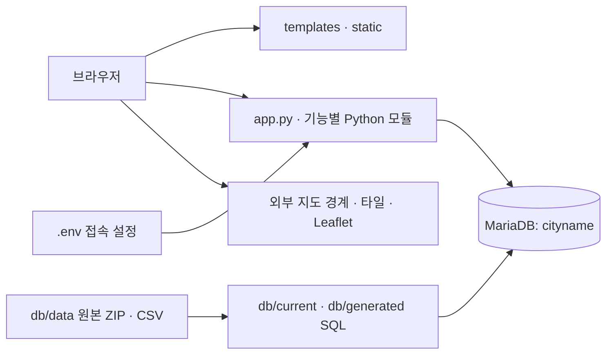

# 웹 실행 파일과 DB 한눈에 보기

확인일: 2026-10-15. 현재 로컬 `app.py`와 연결 모듈, HTML, SQL 파일 기준입니다.

## 전체 흐름



**웹 실행에 필요한 묶음:** 서버 Python 파일 + `templates/` + `static/` + Python 패키지 + DB 접속 설정 + 실행 중인 MariaDB와 데이터.
SQL·CSV 파일은 DB 준비 자료입니다. 파일이 폴더에 있는 것만으로 DB에 자동 저장되지는 않습니다.

## 파일과 폴더 역할

| 위치 | 역할 | 실행 시 필요 여부 |
| --- | --- | --- |
| `app.py` | Flask 시작점, 회원 인증, 지역·장소 조회 API | 필수 |
| `visits.py` | 방문 기록, 후기, 사진 저장·조회 | 필수: app.py가 직접 가져옴 |
| `favorites.py` | 즐겨찾기 저장·삭제·조회 | 필수: app.py가 직접 가져옴 |
| `food_rankings.py` | 데이터랩 맛집 순위 API | 필수: app.py가 직접 가져옴 |
| `food_locations.py` | 순위 맛집을 기존 맛집 좌표와 연결 | 필수: food_rankings.py가 가져옴 |
| `templates/index.html` | 지도 메인 화면 | 필수 |
| `templates/signup.html`, `profile.html` | 회원가입·프로필 화면 | 해당 기능에 필요 |
| `static/css/style.css` | 화면 스타일 | 정상적인 화면 표시에 필요 |
| `static/js/map.js`, `sidebar.js` | 지도, 장소 목록, 사이드바 | 지도 기능에 필요 |
| `static/js/account.js` | 계정 화면 동작 | 계정 기능에 필요 |
| `static/js/visits.js`, `favorites.js`, `food-rankings.js` | 방문·즐겨찾기·맛집 순위 화면 동작 | 해당 기능에 필요 |
| `static/js/auth.js` | 별도 인증 관련 파일 | 현재 확인한 HTML에서는 직접 참조되지 않음 |
| `static/images/regions/manifest.csv` 및 지역 SVG | 지역 로고 목록과 이미지 | 로고 표시에 필요 |
| `static/images/tourist/`, `food/` | 장소 분류 아이콘 | 아이콘 표시에 필요 |
| `.env` | DB 연결 값, 선택적으로 SECRET_KEY | 환경변수로 대신 설정 가능; 현재 폴더에서는 발견되지 않음 |
| `requirements.txt` | Python 패키지 설치 목록 | 환경 준비용 |
| `db/current/` | 현재 기본 테이블과 초기 데이터 SQL | DB 준비·복구용 |
| `db/generated/` | 데이터랩 맛집 순위 SQL과 건수 보고서 | 순위 DB 준비용 |
| `db/data/datalab_food_top20/` | 수집한 원본 ZIP·CSV | 데이터 재생성용, 웹이 직접 읽지 않음 |
| `db/migrations/` | 기존 DB 구조·자료 보강 SQL | 해당 변경을 적용할 때만 사용 |
| `import_geojson_regions.py` | 행정구역 코드와 지역 자료 가져오기 | 데이터 준비용 |
| `tests/`, `docs/`, `inbox/` | 테스트, 설명, 팀 전달 자료 | 서버 실행의 직접 필수 항목 아님 |
| `db/cityname_split/`, `db/legacy/` | 이전 DB 구조와 덤프 | 현재 앱용 초기화 자료와 혼용하지 않음 |

프로젝트 안에 같은 이름의 `Travel-bootcamp-project/` 하위 폴더가 있으나, 확인 시 내부에는 `.git`만 있습니다. 실행 기준은 `app.py`, `templates`, `static`, `db`가 함께 있는 바깥 프로젝트 폴더입니다.

## DB 자료와 화면 연결

앱의 DB 이름은 코드에서 **`cityname`으로 고정**되어 있습니다. `.env`에 DB_NAME을 추가해도 현재 앱은 이를 읽지 않습니다.

| 테이블·뷰 | 보관하는 자료 | 웹에서 쓰는 곳 |
| --- | --- | --- |
| `regions` | 시·도 코드, 이름, 종류, 표시 순서 | 지역 목록 `/api/regions` |
| `localities` | 시·군·구 이름, 소속 시·도 | 행정구역 데이터 기반; 현재 app.py 조회에서는 직접 사용하지 않음 |
| `geo_admin_codes` | 지도 SIG·EMD 코드와 locality 연결 | 행정구역 매핑 자료; 현재 app.py 조회에서는 직접 사용하지 않음 |
| `tourist_landmarks` | 관광지 이름·설명·좌표·링크·출처 | 관광지 목록과 지도 마커 |
| `food_landmarks` | 맛집 이름·설명·좌표·링크·출처 | 맛집 목록·마커, 순위 맛집 좌표 연결 |
| `event_landmarks` | 행사 이름·설명·좌표·링크·출처 | 행사 목록과 지도 마커 |
| `members` | 아이디, 비밀번호 해시, 이름, 생일, 주소, 여행 스타일 | 가입·로그인·프로필 |
| `member_visits` | 회원별 장소, 후기, 사진 바이너리, 수정 시각 | 방문 기록과 사진; 사진은 파일 폴더 대신 DB에 저장 |
| `member_favorites` | 회원별 카테고리·장소 ID·등록 시각 | 즐겨찾기 |
| `datalab_food_rankings` | 지역·기간·방문자 구분별 맛집 순위 원본 | 맛집 순위 옵션·목록 |
| `v_datalab_food_top20` | 위 테이블에서 원래 순위가 20위 이내인 자료 | TOP20 화면; 별도 복제 테이블이 아닌 조회용 뷰 |

기본 9개 테이블 구조는 `db/current/00_schema.sql`에 있습니다. 순위 테이블과 뷰는 `db/generated/datalab_food_rankings.sql`에서 별도로 생성합니다.

관광지·맛집·행사는 `region_code`와 `locality_name`으로 찾습니다. 방문·즐겨찾기의 장소 참조는 `category + landmark_id`이며, 기본 SQL에서는 회원·장소에 대한 DB 외래키를 선언하지 않습니다. 기존 장소 ID를 바꾸면 기록 연결에 영향을 줄 수 있습니다.

### 확인 가능한 데이터 규모

아래는 **로컬 생성 보고서**(`db/generated/datalab_food_rankings.report.json`)의 수치입니다. 이번 확인에서 실제 DB 건수를 조회한 값은 아닙니다.

| 항목 | 보고서 수치 |
| --- | ---: |
| 처리 원본 파일 | 354개 |
| 원본 행 | 35,400건 |
| 제외한 중복 행 | 9,900건 |
| 중복 제거 순위 자료 | 25,500건 |
| 지역 | 85개 |
| TOP20 자료 | 5,100건 |
| 전체·현지인·외지인 | 각각 8,500건 |

기간은 `202507–202606`, `202510–202609` 두 종류입니다. 지역·기간·방문자 구분을 합친 수치이므로 TOP20 5,100건은 서로 다른 식당 5,100개를 의미하지 않습니다.

원본 순위에는 좌표가 없습니다. 현재 코드에서는 같은 지역과 정규화한 식당 이름으로 `food_landmarks`에 단 하나의 일치 항목이 있을 때 유효한 좌표를 연결합니다. 일치하지 않는 순위 자료는 좌표 없이 목록으로 제공합니다.

## 실행 준비 순서

1. `app.py`가 있는 프로젝트 폴더에서 Python 환경과 패키지를 준비합니다.
2. `.env` 또는 환경변수에 DB 연결 값을 설정합니다.
3. MariaDB를 실행하고 `cityname` DB의 테이블과 데이터를 준비합니다.
4. 맛집 순위까지 사용할 경우 별도 순위 SQL을 적용합니다.
5. `python app.py`를 실행하고 `http://127.0.0.1:5000`을 엽니다.

```powershell
cd C:\Users\user\Documents\GitHub\Travel-bootcamp-project
python -m venv .venv
.\.venv\Scripts\python.exe -m pip install -r requirements.txt
.\.venv\Scripts\python.exe app.py
```

현재 `requirements.txt`는 Flask, PyMySQL, python-dotenv 외에 **`yangjaedeok` 한 줄**을 포함합니다. 프로젝트 코드에서 이 이름의 패키지를 사용하는지는 확인되지 않았으므로, 전체 설치 전 팀의 의도나 실제 필요한 패키지인지 확인해야 합니다.

`.env` 설정 항목:

| 이름 | 용도 |
| --- | --- |
| `DB_HOST` | DB 서버 주소 |
| `DB_PORT` | DB 포트, 기본 3306 |
| `DB_USER` | DB 접속 계정 |
| `DB_PASSWORD` | DB 접속 비밀번호 |
| `SECRET_KEY` | 세션 서명 키; 미설정 시 앱 시작마다 무작위 생성 |

`00_schema.sql`은 구조만 만들며 데이터는 채우지 않습니다. `cityname_landmarks_1013.sql`은 기존 일반 테이블을 DROP하고 재생성하는 초기 덤프이므로 기존 DB가 있는 경우 바로 실행하지 마세요. `01~09_*_temp.sql`은 테이블별 준비 자료이고, migration 파일은 기존 구조에 의존할 수 있으므로 전부 일괄 실행하는 순서가 아닙니다.

브라우저는 외부 Leaflet CDN, Google Fonts, 지도 경계 GeoJSON 및 지도 타일을 사용합니다. 로컬 Flask와 DB가 정상이어도 외부 리소스 접속 상태에 따라 지도나 서체 표시가 달라질 수 있습니다.

## 이번 확인 범위와 남은 확인

- 코드·SQL·생성 보고서·템플릿 참조를 확인했습니다. 기존 앱 코드와 DB 자료는 변경하지 않았습니다.
- IDE에 열린 것으로 표시된 `.env`는 현재 프로젝트와 그 하위 폴더의 실제 파일 목록에서 발견되지 않았습니다. 저장 전 탭이거나 다른 위치의 파일일 가능성은 확인되지 않았습니다.
- 현재 명령행 Python으로 앱을 가져오려 했으나 `ModuleNotFoundError`로 중단되어 DB 조회까지 진행하지 못했습니다. IDE가 별도 Python 환경을 사용할 가능성이 있으며, 이번 결과만으로 DB가 비어 있거나 연결 불가능하다고 판단할 수는 없습니다.
- 실제 DB별 테이블 존재 여부, 건수, 현재 회원·방문·즐겨찾기 자료는 검증되지 않았습니다. 위 건수는 생성 자료의 보고서 값으로 구분했습니다.

관련 상세 문서: [DB 안내](../db/README.md), [맛집 순위 안내](../db/generated/README.md), [회원 인증](member-auth.md), [방문 기록](visit-records.md), [즐겨찾기](favorites.md).
